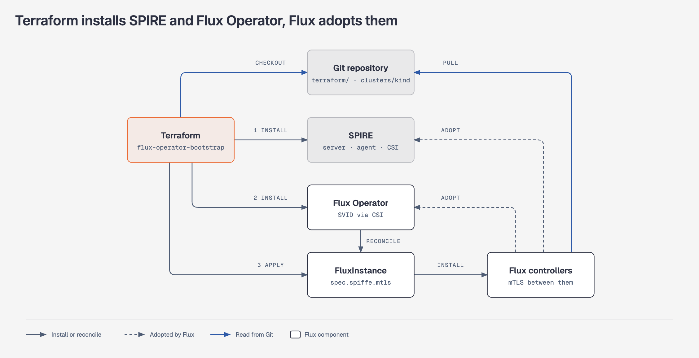
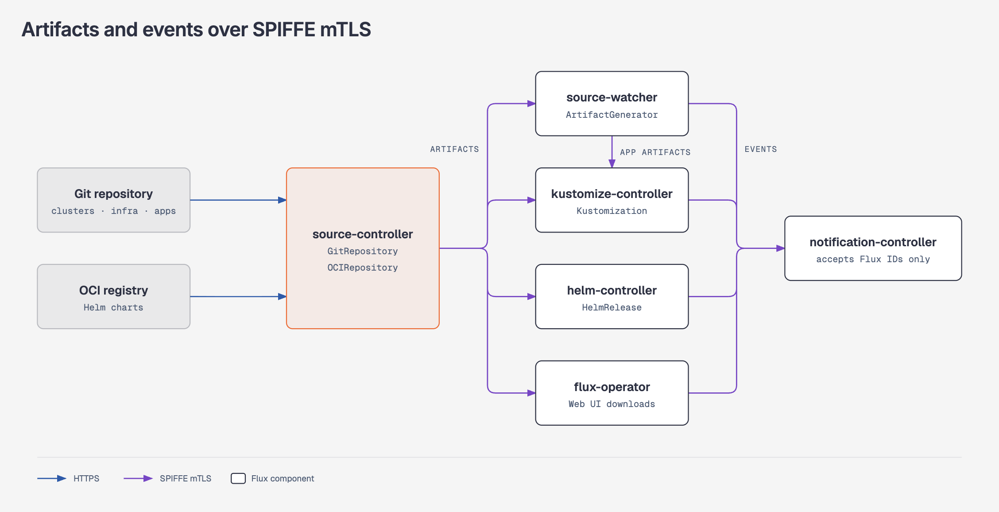
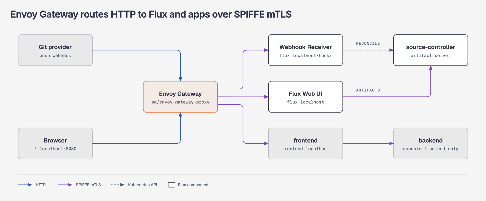
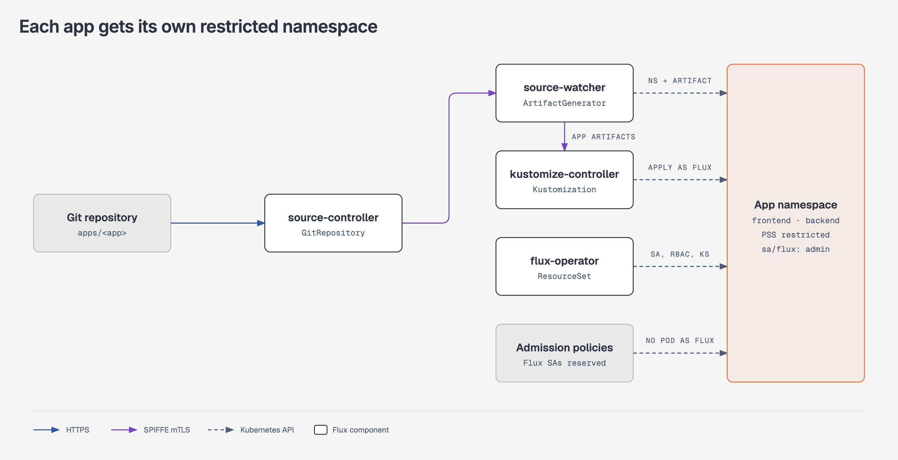

# flux-operator-mtls-example

Zero-trust GitOps with SPIFFE/SPIRE: mTLS between the Flux controllers, Envoy
Gateway, the Web UI and workloads, bootstrapped with Terraform and Flux Operator.

SPIRE issues X.509-SVIDs to the Flux controllers, the flux-operator, the Envoy
Gateway proxy and the app pods. Every in-cluster hop is SPIFFE mTLS, and each
server accepts only the SPIFFE IDs it expects. Requires Flux 2.10.

## How it works

### Bootstrap with Terraform

<picture>
  <source media="(prefers-color-scheme: dark)" srcset="diagrams/terraform-bootstrap-dark.png">
  
</picture>

- The [flux-operator-bootstrap](https://fluxoperator.dev/docs/guides/install/#terraform)
  Terraform module installs SPIRE first. The operator pod needs its SVID from
  the SPIFFE CSI driver before it can install the controllers with mTLS.
- The module then installs Flux Operator and applies the
  [FluxInstance](https://fluxoperator.dev/docs/crd/fluxinstance/), which syncs
  `clusters/kind` from this repository.
- Terraform reads the SPIRE and flux-operator values files with `file()`, and
  the HelmReleases read the same files through generated ConfigMaps, so the
  bootstrap install and the Flux-managed release are identical.
- helm-controller adopts the SPIRE and flux-operator releases. From then on
  the bootstrap skips them and upgrades come from the HelmRelease semver
  ranges.

See the [bootstrap gotchas](#bootstrap).

### Mutual TLS between Flux components

<picture>
  <source media="(prefers-color-scheme: dark)" srcset="diagrams/mtls-artifacts-dark.png">
  
</picture>

- The FluxInstance enables
  [SPIFFE mTLS](https://fluxoperator.dev/docs/crd/fluxinstance/#mtls-configuration) with
  `.spec.spiffe.mtls` and derives each controller's SPIFFE ID from
  `componentIDTemplate`.
- source-controller and source-watcher serve artifacts only to clients with an
  authorized SPIFFE ID: kustomize-controller, helm-controller, source-watcher
  and flux-operator (Web UI downloads).
- notification-controller accepts events only from the Flux controllers and
  flux-operator.

| Workload | SPIFFE ID | mTLS peers |
|---|---|---|
| source-, kustomize-, helm-, notification-controller, source-watcher | `spiffe://example.org/ns/flux-system/sa/<controller>` | each other |
| flux-operator | `spiffe://example.org/ns/flux-system/sa/flux-operator` | source-controller (Web UI downloads), notification-controller (events) |
| Envoy proxy | `spiffe://example.org/ns/envoy-gateway-system/sa/envoy-gateway-proxy` | flux-operator Web UI, notification-controller Receiver, podinfo frontend |
| podinfo frontend | `spiffe://example.org/ns/frontend/sa/podinfo` | accepts Envoy only, calls the backend |
| podinfo backend | `spiffe://example.org/ns/backend/sa/podinfo` | accepts the frontend only |

See the [Flux controller gotchas](#flux-controllers).

### Ingress through Envoy Gateway

<picture>
  <source media="(prefers-color-scheme: dark)" srcset="diagrams/mtls-ingress-dark.png">
  
</picture>

- Envoy Gateway calls every backend with its own SVID, fetched over SDS, and
  BackendTLSPolicies verify each backend's SPIFFE ID.
- The `flux` listener (`flux.localhost`) routes `/hook/` to the
  notification-controller
  [webhook Receiver](https://fluxoperator.dev/docs/crd/receiver/)
  and `/` to the Flux Web UI. The FluxInstance authorizes Envoy's SPIFFE ID on
  the Receiver with `.spec.spiffe.mtls.receivers`.
- The `apps` listener (`*.localhost`) routes to the apps. The frontend accepts
  only Envoy, calls the backend over SPIFFE mTLS, and the backend accepts only
  the frontend.

See the [ingress gotchas](#ingress).

### Apps and tenancy

<picture>
  <source media="(prefers-color-scheme: dark)" srcset="diagrams/apps-tenancy-dark.png">
  
</picture>

- An [ArtifactGenerator](https://fluxoperator.dev/docs/crd/artifactgenerator/)
  splits `apps/` into one ExternalArtifact per app, published by source-watcher
  into a namespace it creates with the `restricted` Pod Security Standard
  enforced.
- A [ResourceSet](https://fluxoperator.dev/docs/crd/resourceset/) discovers the
  artifacts and reconciles each app as the `flux` ServiceAccount, with admin
  rights in its own namespace only.
- Two ValidatingAdmissionPolicies stop other workloads from running as the
  Flux ServiceAccounts.

See the [tenancy gotchas](#tenancy).

## Layout

```text
terraform/                  kind cluster and bootstrap module
clusters/kind/
  flux-system/              FluxInstance, flux-operator HelmRelease, values, RBAC and
                            ServiceAccount admission policies
  infrastructure.yaml       ResourceSet: one Kustomization per infrastructure/ component
  apps.yaml                 ArtifactGenerator, input provider and ResourceSet for apps/
infrastructure/
  spire/                    SPIRE HelmReleases and values (shared with Terraform)
  envoy-gateway/            Envoy Gateway HelmRelease
  gateway/                  EnvoyProxy, Gateway, HTTPRoutes, BackendTLSPolicies, Receiver,
                            Gateway API rights for the app ServiceAccounts
apps/
  frontend/                 podinfo exposed at frontend.localhost, calling the backend
  backend/                  podinfo accepting only the frontend
scripts/e2e.sh              end-to-end test
diagrams/                   architecture figures: HTML source, light and dark PNG renders
```

## Run it on kind

Requirements: Terraform >= 1.11, Docker, kubectl.

Flux syncs this repository from GitHub. To test changes, push them to a branch
and pass its ref.

```shell
cd terraform
terraform init
terraform apply \
  -var git_ref=refs/heads/main \
  -var receiver_token="$(openssl rand -hex 16)"
```

kind adds the `kind-flux-mtls` context to `~/.kube/config` and makes it the
current context. `terraform destroy` removes it and leaves no current context
set; switch back with `kubectl config use-context`.

Forward the Envoy Gateway port:

```shell
kubectl -n envoy-gateway-system port-forward svc/envoy 8080:80
```

The Gateway routes by hostname. Names under `.localhost` resolve to the
loopback address without DNS or `/etc/hosts` entries.

- Flux Web UI: <http://flux.localhost:8080>
- frontend app: <http://frontend.localhost:8080>. Its `/echo` endpoint calls the
  backend over SPIFFE mTLS.

Call the Receiver through Envoy:

```shell
WEBHOOK_PATH=$(kubectl -n flux-system get receiver/flux-system -o jsonpath='{.status.webhookPath}')
curl -X POST -H 'Content-Type: application/json' -d '{}' "http://flux.localhost:8080${WEBHOOK_PATH}"
```

Delete the cluster with `terraform destroy` (pass the same variables).

To bootstrap an existing cluster instead, delete `terraform/kind.tf` and
configure the `helm` and `kubernetes` providers for your cluster.

## End-to-end test

```shell
./scripts/e2e.sh
```

The script creates the cluster, runs the checks below and destroys it. It
syncs the current branch, which must be pushed; set `GIT_REF` to override and
`KEEP_CLUSTER=true` to keep the cluster.

- The FluxInstance is Ready and reports mTLS enabled; all Kustomizations and
  HelmReleases are Ready.
- The SPIRE ClusterSPIFFEIDs select the Flux, Envoy and app pods.
- helm-controller owns the SPIRE and flux-operator releases, and a second
  bootstrap run does not upgrade them.
- The ArtifactGenerator manages the app namespaces, which enforce the
  `restricted` Pod Security Standard, and their ExternalArtifacts are Ready.
- The frontend ServiceAccount can manage its own namespace and nothing else.
- Pods cannot run as `flux` in any namespace, and workloads in `flux-system`
  cannot use the Flux controller ServiceAccounts.
- source-controller and source-watcher answer plain HTTP with 400.
- The Web UI and the Receiver reject TLS clients without an SVID.
- A Receiver call through Envoy reaches notification-controller.
- The Web UI loads through Envoy and an artifact download returns a valid
  tar.gz.
- The frontend UI is served through the Gateway apps listener over SPIFFE
  mTLS, and the frontend rejects clients without an SVID.
- The frontend gets the backend echo over SPIFFE mTLS, the backend logs the
  frontend's SPIFFE ID and rejects clients without an SVID.

CI runs the same script on pull requests, pushes to `main` and weekly.

## Gotchas

### Bootstrap

- **SPIRE must run before the operator.** The operator pod mounts the SPIFFE
  CSI socket and needs its SVID to install controllers with mTLS. That is why
  SPIRE is a bootstrap prerequisite rather than a Flux-only install.
- **Adopted releases must keep the bootstrap release names and namespaces**,
  otherwise helm-controller installs a second release. Chart versions in
  `terraform/main.tf` only set the first install.

### Flux controllers

- **Flux >= 2.10.** The operator rejects `.spec.spiffe` on older versions. An
  existing 2.9 instance can be upgraded and switched to mTLS in one commit.
- **ClusterSPIFFEIDs need `spec.className`.** The SPIRE controller manager
  ignores entries without the chart's class (`spire-system-spire`). The
  identities are defined in the SPIRE chart values, which set it.
- **Artifact URLs keep `http://`.** `.status.artifact.url` still shows
  `http://`; the controllers switch to `https` when mTLS is enabled.
- **Alerts leave the mTLS boundary.** notification-controller calls Provider
  endpoints without SPIFFE mTLS; support arrives in Flux 2.11.

### Ingress

- **The Web UI is open.** It uses anonymous authentication and the anonymous
  group is bound to `cluster-admin`
  (`clusters/kind/flux-system/web-admin.yaml`). Anyone who reaches the UI has
  full control of the cluster. Configure
  [user management](https://fluxoperator.dev/docs/web-ui/user-management/)
  before using this outside a throwaway cluster.
- **No public TLS.** The Gateway listens on plain HTTP and is only reachable
  through a port-forward. Terminate TLS with your own certificate before
  exposing it.
- **NetworkPolicies.** The Flux `allow-webhooks` policy admits the Receiver
  port and the flux-operator chart admits the Web UI port from all
  namespaces, so Envoy needs no extra policy.
- **Apps expose themselves on the Gateway.** The `apps` listener accepts
  HTTPRoutes only from namespaces labelled `app.kubernetes.io/part-of: apps`;
  the `flux` listener only from `flux-system`, and its exact hostname wins
  over the wildcard. Gateway API does not aggregate its RBAC into the `admin`
  role, so `infrastructure/gateway/tenant-rbac.yaml` does it for HTTPRoutes
  and BackendTLSPolicies. A BackendTLSPolicy can only reference a CA Secret in
  its own namespace, so the apps ResourceSet puts the SPIRE trust bundle SDS
  Secret in every app namespace.

### Tenancy

- **Multi-tenancy lockdown is on.** Flux impersonates `<namespace>/default`
  for objects without a `serviceAccountName`, so every Kustomization and
  HelmRelease sets one. Infrastructure runs as `flux-operator` in
  `flux-system` and as `flux` in the component namespaces, bound to
  `cluster-admin`. Apps run as `flux` in their own namespace, bound to the
  namespaced `admin` role. Cross-namespace source references are disabled, so
  the ArtifactGenerator publishes each app's ExternalArtifact into the app
  namespace instead of the apps referencing the flux-system GitRepository.
- **The Flux ServiceAccounts are reserved.** Two ValidatingAdmissionPolicies
  (`clusters/kind/flux-system/serviceaccount-policies.yaml`) stop other
  workloads from borrowing Flux rights. No pod may run as `flux`, the
  ServiceAccount Flux impersonates in every infrastructure and app namespace.
  In `flux-system`, a controller ServiceAccount is only admitted for the
  Deployment of the same name, its ReplicaSets and their pods; a chart
  installed there needs its own ServiceAccount. Other workload kinds
  (StatefulSets, DaemonSets, Jobs, CronJobs, ReplicationControllers) are
  denied a Flux ServiceAccount when created.
- **source-watcher needs namespace RBAC.** The ArtifactGenerator authorizes
  namespace management against its ServiceAccount, but source-watcher creates
  and deletes the namespaces with its own credentials, and Flux grants it only
  read access to namespaces
  (`clusters/kind/flux-system/source-watcher-rbac.yaml`).

## License

[AGPL-3.0](LICENSE)
